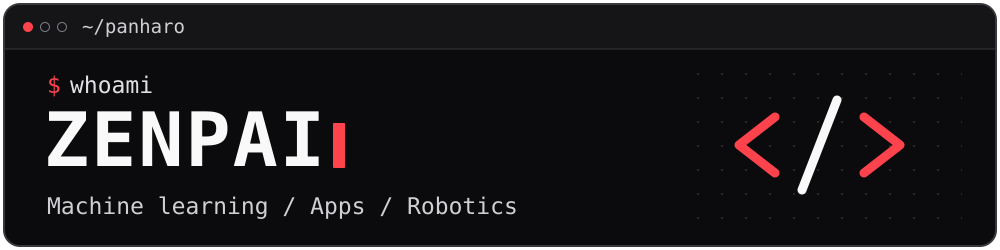

# Hey, I'm Keo Sovannpanharo

I'm a university student in Cambodia. I build machine learning projects and apps around things I know firsthand, from shopping for a laptop on a student budget to remembering the restaurants I saved on TikTok.

## Building now

### [AI Laptop Recommender](https://github.com/PANHARO/ai_laptop_recommender)

Helping Cambodian university students find laptops that fit their budget and how they'll use them. I'm building a catalog of verified local offers and testing how a price baseline, spec matching, Random Forest, and a small neural network rank the options.

### [BiteRadar](https://github.com/PANHARO/bite-radar)

An Expo app for saving food spots from TikTok and finding them again on a map. The prototype saves places on-device. The next milestone is reminding you when you're near one.

I'm also working on route planning and simulator benchmarks for the **Kibo Robot Programming Challenge**.

## Featured projects

| Project | What I built |
| :--- | :--- |
| **[TypeRush](https://github.com/PANHARO/TypeRush)** | A typing game with timed WPM tests and a survival mode where correct words earn you more time. Available as a C++/Qt desktop app and an installable web app that works offline. |
| **[FoodImage](https://github.com/PANHARO/FoodImage)** | A computer vision toolkit that trains and evaluates MobileNetV2 and EfficientNet-B0 on 10 Southeast Asian dishes, including Cambodia's fish amok. |
| **[Shape Classification](https://github.com/PANHARO/shape-detection)** | An OpenCV experiment that uses contour features to compare three classifiers across 17 shape classes. |
| **[TRACE](https://github.com/PANHARO/ENVS)** | A browser prototype for logging meals and transport, estimating their environmental impact, and setting weekly goals. |

**Lab notebooks** · [Deep learning](https://github.com/PANHARO/AI_class) · [Machine learning](https://github.com/PANHARO/machine-learning-class)

## Toolbox

`Python` · `PyTorch` · `scikit-learn` · `OpenCV` · `TypeScript` · `React Native / Expo` · `C++ / Qt` · `Docker`

[Email me](mailto:panharokeo097@gmail.com) · [Browse my repos](https://github.com/PANHARO?tab=repositories)
